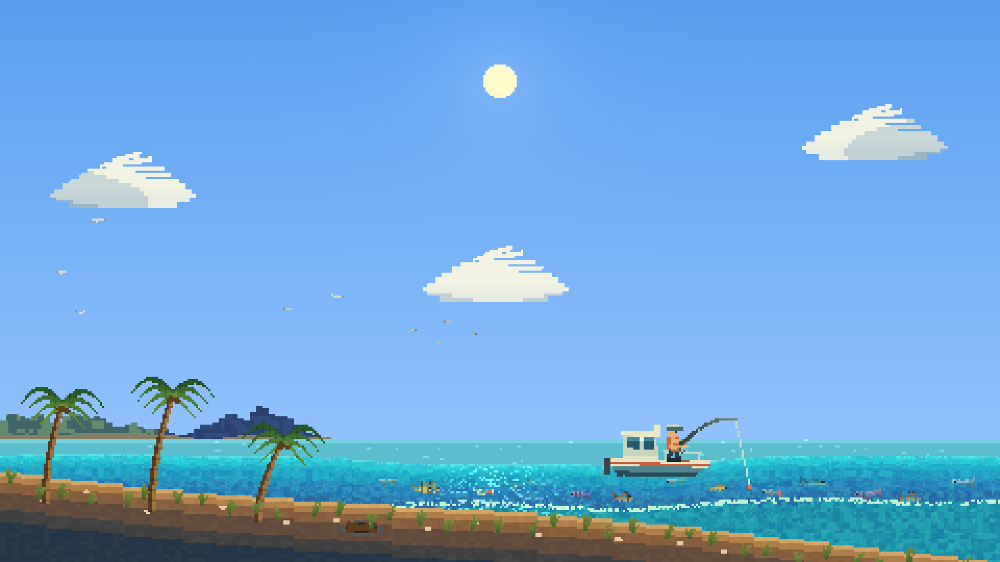
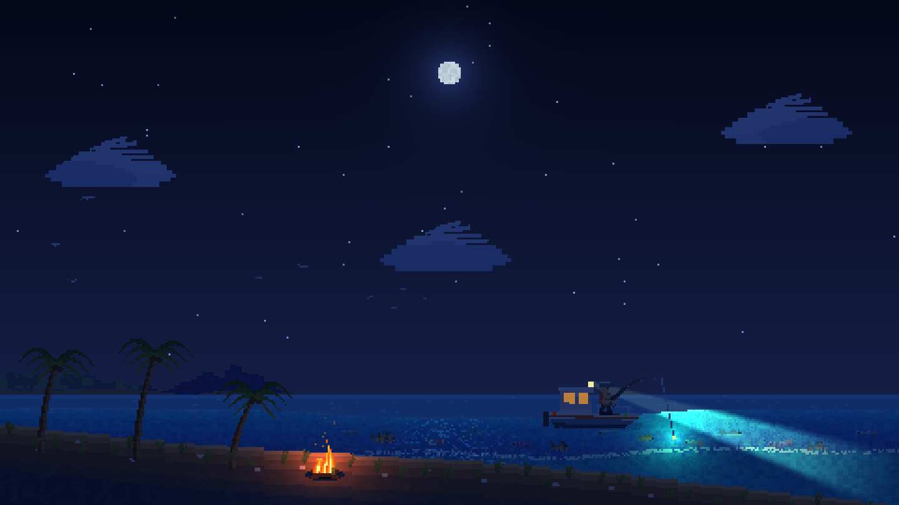
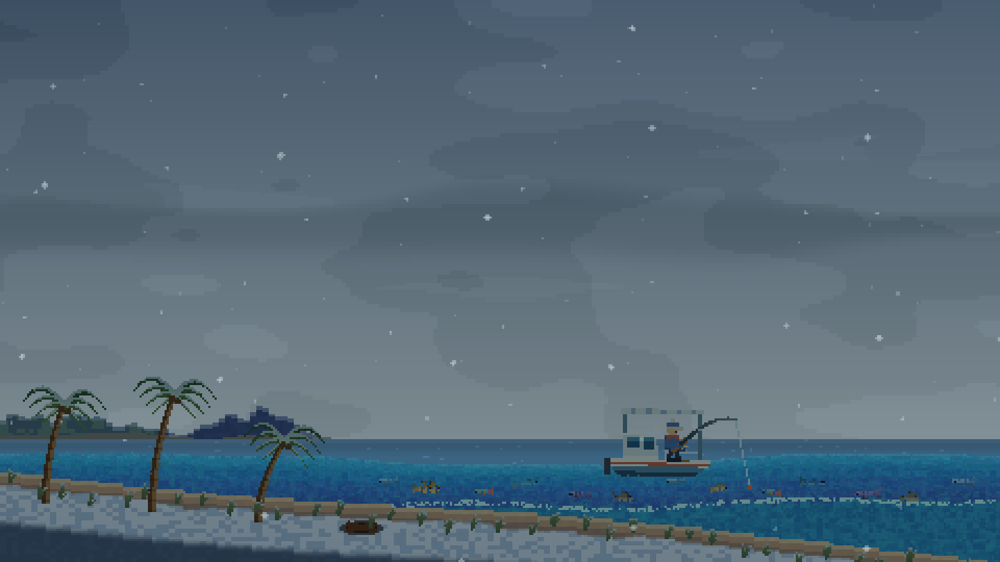

# PixelFishing

一个可以慢慢看的像素风海岸与自动路亚钓鱼小景。原生 WebGL、JavaScript 和 GLSL 实现，无前端构建步骤、CDN 或运行时第三方依赖。Created by **ybwangrogger**。

[在 itch.io 游玩 FixelFishing](https://ybwangrogger.itch.io/fixelfishing)



## 一小片海，四季与昼夜

- 一分钟昼夜循环、每季约两分钟，四季连续过渡；晴、云、风、雨、雪和雷阵雨各有天空与环境光。
- 三层景深雨雪、同向风场、积雪与融雪；有云时飞鸟散去，晴天以不同距离与振翅飞向远处。
- 原创像素小游艇随浪起伏，雨雪自动展开船篷，冬季人物穿上冬装；傍晚舱窗与探照灯渐亮，灯束在船前海面小角度扫动。
- 六种不同颜色与外形的鱼自然游动，夜间靠近实际光暗交界。自动抛投、追饵、挣扎与收鱼；每次拉锯有 50% 概率成功。
- 左侧可折叠图鉴：鱼图标、钓获数量、数量 × 稀有度分值、成就与卡片互动。稀有度是游戏计分，不代表实际捕获概率。
- 夜光鱼饵、独立暖色篝火、示廓灯与可选分叉闪电。雷声和闪电默认关闭，声音须主动开启；减少动态效果偏好会关闭闪电。




这是固定侧面机位的 2.5D 程序化场景，不是完整流体模拟或任意视角三维海洋。

## 本地运行

安装 Node.js 18 或更高版本，使用支持 WebGL、启用硬件加速的浏览器：

```sh
node server.mjs
```

打开 http://127.0.0.1:5173 。Windows 也可以双击 `start.bat`。服务只监听本机，无需互联网；按 Ctrl+C 停止。请通过 HTTP 服务打开，不要直接双击 `dist/index.html`，因为着色器需要加载。

## 操作

| 操作 | 效果 |
| --- | --- |
| 拖动游艇 / 点击海面 | 左右航行，钓鱼自动进行 |
| 左侧图鉴按钮 / 鱼卡片 | 展开收集与积分、查看鱼种；Escape 收起 |
| 季节 / 天气标签 | 切换预览；设置中可恢复自动 |
| 拖动天空 / Shift + 拖动海面 | 平移视角 |
| 滚轮 | 缩放 |
| H / 设置按钮 | 展开浪高、速度、像素大小等设置 |
| 暂停 | 暂停海浪、自由鱼和钓鱼，取消雷声；昼夜、季节与天气继续 |
| 重置视角 | 恢复构图，不清除图鉴 |

界面支持窄屏和触屏指针操作；具体设备性能取决于浏览器与 GPU，未承诺手机固定帧率。

图鉴使用浏览器本地存储，刷新后保留。不同网站、浏览器或设备不共享；清除网站数据可能丢失记录。嵌入页禁用存储时会退回当前会话内记录。无需账号，没有云存档。

## 项目结构

- `dist/`：可独立部署的静态游戏；运动、钓鱼、鱼种、图鉴、季节、天气、鸟群、探照灯、闪电和音频模块，以及 GLSL 着色器。
- `server.mjs` / `start.bat`：本地服务器。
- `tests/`：当前逻辑、转场、音频控制与渲染回归；历史对比脚本需要各自指定的旧版本目录。
- `tools/`：统一测试入口、离屏预览和视频分析。
- `publishing/itch/`：页面说明与实际场景渲染图。
- `ITCH-PUBLISH.md`：发布步骤和主分支自动上传注意事项。

## 验证与开发工具

网页运行不需要 Python。运行所有当前 JavaScript 回归：

```sh
node tools/test.cjs
node tools/prepare-preview.cjs
```

可选离屏渲染需要 Python 3.10+、`requirements-dev.txt` 中的依赖和可用的 EGL/OpenGL 驱动：

```sh
python -m pip install -r requirements-dev.txt
python tools/verify_render.py
python tools/verify-clouds.py
python tools/verify-lure-light.py
python tools/verify-campfire.py
python tests/gles_compile.py
```

生成结果保存在忽略的 `analysis/` 或命令指定目录。桌面 EGL 预览会转换 GLSL 接口声明；`gles_compile.py` 另行验证原始 GLES 着色器。它们不等同于真实浏览器、手机触屏或 itch 嵌入页验收。页面中的场景图是当前代码的实际离屏渲染，不是界面截图。

## 视觉参考

本项目的像素海岸、侧面机位和海浪色彩受到 **Surf Sandbox** 视频的启发：

[The Most Relaxing Surfing Game Ever? — Surf Sandbox](https://www.youtube.com/watch?v=4t6VF38VYzw)

本项目是独立实现的风格练习，并非原游戏源码或官方项目。仓库仅记录参考链接，不包含原视频、视频抽帧、本地预览视频或本地开发依赖。场景中的图形由代码生成。
